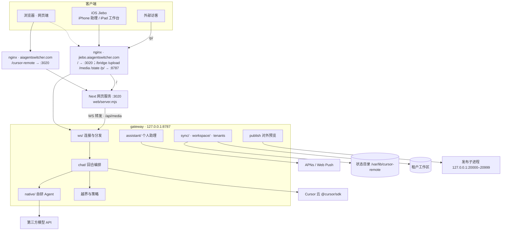

# 系统架构与程序说明

基于 main `9c5ac13`。本文写给第一次接手代码的人：先看整体拓扑，再按“一轮对话怎么跑完”顺着读代码，最后是各目录职责、持久化、部署与测试。产品介绍和使用方式见 [README](../README.md)，多设备同步细节见 [chat-sync.md](./chat-sync.md)。

## 1. 一句话

浏览器和 iOS 客户端经 WSS 连到 VPS 上的**网关**（gateway）；网关按所选模型把每轮对话交给 **Cursor SDK** 或**自研 Agent**（第三方模型），在租户工作区里读改文件、跑命令，把流式事件发回发起设备；会话、助理、对外预览等状态按租户落在状态目录里。

## 2. 拓扑



两个入口的区别：

- **主站** `aiagentswitcher.com/cursor-remote`：nginx 只转到网页服务（`scripts/insert-nginx-cursor-remote.py`），WebSocket `/cursor-remote/bridge` 由 `web/server.mjs` 再转给网关，媒体走 Next 的 `app/api/media/route.ts` 反代。
- **子域** `jiebo.aiagentswitcher.com`：nginx 直接把 `/bridge`（→ 网关 `/ws`）、`/upload`、`/media`、`/state`、`/p/` 转给网关，其余到网页服务（`scripts/nginx-jiebo.aiagentswitcher.com.conf`）。iOS 走这条。

新增公开 HTTP 地址必须挂在上面这些前缀下，否则要改服务器 nginx。

## 3. 仓库结构

npm workspaces，三端共用 `shared/`。

| 目录 | 技术 | 规模（行） | 说明 |
|---|---|---|---|
| `gateway/` | Node 22 + tsx，ESM | src 约 21.9k | 网关服务；`import index.ts` 即启动 |
| `web/` | Next 15.5 + React 19 | 约 26.3k | 网页端 |
| `ios/` | SwiftUI，iOS 26 SDK | 约 25.1k | Jiebo App；工程用显式文件引用 |
| `shared/` | TypeScript | 约 1.8k | 协议、策略、方言、工具名判定 |
| `scripts/` | Node / bash / Python | 约 5.0k | 冒烟、bench、迁移、部署 |
| `docs/` | Markdown | — | 设计文档 |

## 4. 一轮对话的完整链路

按这个顺序读代码最快。

| 步 | 位置 | 做什么 |
|---|---|---|
| 1 | `web/components/ChatApp.tsx`、`ios/.../ChatStore+Composer.swift` | 客户端发 `prompt` |
| 2 | `gateway/src/ws/dispatch.ts` | `parseClient`；未鉴权只认 `hello`，之后按 `handlers[type]` 分发，未知类型忽略 |
| 3 | `gateway/src/ws/handlers/prompt.ts` | `onPrompt`：记回合；槽位忙则排队；首条消息异步生成标题 |
| 4 | `gateway/src/chat/runner.ts`、`chat/prompt.ts` | `handlePrompt`：拼工作区规则、方言提示，打开 transcript，按模型选执行路径 |
| 5a | `gateway/src/chat/agent.ts` | Cursor 模型：`ensureAgent` → `Agent.create/resume` → `send` + `stream` |
| 5b | `chat/native.ts` → `native/loop.ts`；`chat/external.ts` | 第三方模型：带工具走 `runNativeChat` → `runNativeLoop`（adapter 为 openai / anthropic / xml）；纯问答走 `runExternalChat` |
| 6 | `chat/tools.ts`、`chat/shellWrites.ts`、`native/confine.ts`、`shared/policy.ts` | 工具调用拦截：越界写入硬拦、策略禁用、写入确认（`approval` ↔ `approval_reply`） |
| 7 | `gateway/src/ws/send.ts` | `text-delta` / `thinking-delta` / `tool-*` 只发给发起设备；其他设备约 800ms 收一次 `run_snapshot` |
| 8 | `chat/finish.ts`、`turnFiles.ts`、`sync/transcript.ts` | `finishRun`：发 `done`，算本轮文件 `turn.files`，正文落盘 |
| 9 | `web/lib/chat/reducer.ts`、`ios/.../ChatStore+Handle.swift` | 客户端把消息折成本地会话与回合 |

越界拦截要点：路径统一用 `pathInside.ts` 的 `isInside` / `relEscapes` 判断，按 realpath 比较防符号链接绕过；shell 写命令（rm / mv / cp / install / rsync 等，含 sudo / env / timeout 等包装）也检查目标；`/tmp`、系统临时目录和 `/dev/*` 只对新增的写命令检查放行，重定向规则不放行。

## 5. 网关（gateway/src）

### 启动顺序（`index.ts`）

1. `loadDotEnv`（只填未定义的变量）→ 读端口、地址、默认模型等
2. `loadTenants()` → 清理状态目录临时文件（嵌套目录的清理延后 10 秒异步执行）
3. 各租户沙箱检查、压缩会话
4. 创建对外预览控制器
5. HTTP 服务：publish → `/health` → `/media/cal/` → `/media` → `/state` → `/upload` →（可选）反代网页
6. WebSocket 服务（`maxPayload` 96MiB，开启 deflate）；`upgrade` 依次交给 publish、WS 路径判断、`onConnection`
7. 绑定 Loop、后台作业，启动助理
8. `listen` → 拉起已登记的对外预览

### 目录职责

| 目录 / 文件 | 职责 |
|---|---|
| `ws/`、`ws/handlers/` | 连接、鉴权、分发、出站；`frameFor` 按客户端声明的帧上限裁剪大消息。处理器按领域分文件：hello、prompt、sessions、state、files、workspaces、checkpoints、loops、assistant、admin |
| `http/` | `routes.ts`（upload / media / state）、`health.ts`、`proxy.ts` |
| `chat/` | 回合编排：runner、agent、prompt、finish、history、title、review、models，以及工具拦截 tools / shellWrites |
| `native/` | 自研 Agent：loop、adapters（openai / anthropic / xml）、tools（fs / shell / task）、mcp、上下文压缩、路径围栏 confine |
| `assistant/` | 个人助理：收件箱、委派子会话、个人记忆、工作区记忆（`.jiebo/memory.md`）、日程待办、cron、后台作业、APNs 与 Web Push |

### 产物投影

`assistant_get` 的 `AssistantState.artifacts` 是只读派生数据，不是新的事实源：`assistant/artifactProjection.ts` 每次从当前租户既有会话的 `turn.files`、委派记录和 Share Assistant 收件箱的结构化 `capture` 字段构建，按时间和稳定 ID确定排序，最多返回 200 条；不写 `artifacts.json` 一类索引。委派文件以 `sourceChatId + sourceTurnId + path + sha/diffSha` 去重，文件只暴露工作区相对路径，绝对路径和越界路径直接丢弃；链接只接受捕获入口已校验并持久化的 HTTP(S) URL，不从收件箱正文或 actionPrompt 反解析，也不投影聊天正文、令牌或委派任务正文。

iPhone 从小驳菜单进入「产物中心」，仍在现有小驳导航栈内，不增加主 Tab。文件复用 `openTurnFile` / `PreviewPanelView`，链接走系统 `Link`；「让小驳继续处理」会带相对路径或安全 URL 和来源标签，固定提交到助理主会话，并在提交后恢复用户原草稿，避免串到工作区会话。
| `bindings/` | 把 Loop 和委派接到宿主运行时 |
| `runtime/` | `GatewayState`：连接、槽位、取消、审批等待、环境缓存 |
| `sync/` | `storedState.ts`（状态摘要与下发）、`transcript.ts`（运行中落盘） |
| `workspace/` | 文件读写、git 与影子 git、检查点、工作区增删改 |
| `auth/` | 登录失败限流：全表清理 60 秒节流，超限淘汰最早一条 |
| `tenants.ts` | 多租户加载、令牌解析、沙箱与围栏 |
| `publish.ts` | `/p/<id>/` 对外工作台：起停子进程、巡检、反代 |
| `providers.ts` | 读 `providers.json`，按 `provider:model` 路由第三方模型 |
| `chatBodies.ts` | 会话正文分段存盘（每段 100 轮），内存最多缓存 16 个会话、合计 64MB |
| `turnFiles.ts` | 本轮文件清单与 artifacts 快照配额 |
| `loops.ts` | 产品 Loop 调度 |
| `usage.ts`、`cursorBill.ts` | 自计量用量；Cursor 官方账单 |
| `config.ts` | 全部环境变量的唯一清单 `ENV_SPECS`（`npm run check:env` 校验） |
| `fsAtomic.ts`、`log.ts`、`pathInside.ts` | 原子写、日志（`GATEWAY_LOG_FORMAT=json` 输出 JSON）、路径包含判断 |

## 6. 共享层（shared/）

| 文件 | 内容 |
|---|---|
| `protocol.ts` | 客户端消息 39 种、服务端消息 47 种，三端唯一协议来源 |
| `protocol-fixtures.ts` → `fixtures/protocol.json` | 每种消息的金样本；`npm run gen:protocol-fixtures` 生成，iOS 契约测试解码它 |
| `policy.ts` | baseline / plane 两种策略、工具类别、ask / plan 模式禁用工具 |
| `dialect.ts` | 中文系模型（glm、kimi、qwen、deepseek 等）的提示补充 |
| `toolNames.ts` | “工具是否改写 / 写入 / 删除 / 写文件”按整词判定；网关和网页共用，iOS 的 `ChatModels.swift` 里 `enum ToolNames` 逐字照搬，改规则要两边同改 |
| `crew.ts`、`preview.ts`、`publishPrompt.ts` | 评审角色、预览 MIME、对外发布提示词 |

客户端消息分组：连接（hello、ping）、工作区、运行（prompt、cancel、set_model、set_policy、approval_reply 等）、会话、文件、检查点、同步（sync_state、sync_chat、load_chat 等）、Loop、助理、管理。

## 7. 网页端（web/）

| 位置 | 职责 |
|---|---|
| `app/page.tsx` | 首页，渲染 `ChatApp` |
| `app/api/media/route.ts` | 反代网关 `/media` |
| `app/canvas-runtime/` | 画布 iframe 运行页 |
| `app/styles/*.css`、`*.module.css` | 全局样式按区域分片；组件专属样式用 CSS Modules |
| `components/ChatApp.tsx` | 主壳：连接、会话状态、发 prompt、浮层编排（约 4.2k 行） |
| `components/chat/` | Thread、Composer、Sidebar（含 `sidebar/`）、LoginGate、Settings 以及 Files / Grep / Terminal / Loop / Workspace / Admin 等浮层 |
| `lib/chat/reducer.ts` | 服务端消息 → 本地会话与回合的纯变换（有单测） |
| `lib/chat/connection.ts` | 网关地址：优先 `NEXT_PUBLIC_GATEWAY_WS`，否则同源 `{basePath}/bridge`；hello 声明 8MiB 帧上限 |
| `lib/chat/storage.ts`、`lib/chatCache.ts` | localStorage 键；IndexedDB 正文缓存 |
| `lib/canvas/` | 画布：sucrase 编译，只允许导入 react 与 `cursor/canvas`，在 iframe 里映射到 `sdk.tsx` 的组件 |

状态写法约定：先同步算出新的会话列表写进 `chatsRef`，再 `setChats`（`applyChats` / `commitSync`），避免后续分支读到旧值。

## 8. iOS（ios/Jiebo）

| 位置 | 职责 |
|---|---|
| `Gateway/GatewayClient.swift` | `URLSessionWebSocketTask` 长连接 |
| `Gateway/Protocol.swift` | `shared/protocol.ts` 的 Swift 镜像；声明帧上限 900KB |
| `Gateway/Uploader.swift` | HTTP `/upload`；状态太大时网关回 `stored_state_deferred`，改走 HTTP `/state` |
| `Session/ChatStore+*.swift` | 会话状态，按 Handle、Sync、TurnsLoad、Composer、Assistant 等拆分 |
| `Views/` | iPhone 以助理为首屏（PhoneShell），iPad 为工作台 |
| `ContractTests/` | 解码金样本的协议契约，以及工具名判定用例 |

新增 Swift 文件要加进 `project.pbxproj` 的 FileReference、BuildFile、group、Sources 四处。

## 9. 持久化与多租户

```
/var/lib/cursor-remote/            CURSOR_REMOTE_STATE_DIR
  providers.json                    第三方模型（可选）
  loops.json                        产品 Loop
  tenants/<id>/
    state.json                      元数据 v2（不含正文）
    chats/<chatId>/<sha1>.json      会话正文，每段 100 轮
    chats-broken/                   损坏文件备份
    artifacts/<sha256>              本轮文件快照
    assistant/                      收件箱、记忆、推送订阅、委派
    publish.json                    对外工作台启动命令
    workspace/                      租户工作区根
```

- 多租户名单来自 `CURSOR_REMOTE_TENANTS_FILE`；没有名单时用 `CURSOR_REMOTE_TOKEN` 跑单租户（上海站就是单租户）。
- WebSocket 用 `hello` 携带令牌鉴权；HTTP 的 `/upload`、`/media`、`/state` 用 Bearer 或签名票据。
- 正文以网关为准：客户端 `sync_chat` 只传元数据，按需 `load_chat` 分页拉回合；有回合的会话 `cwd` 以服务端为准。
- 所有状态写盘经 `fsAtomic` 的原子写（临时文件 + rename）。

## 10. 部署

| 项 | 说明 |
|---|---|
| `scripts/cursor-remote-gateway.service` | tsx 直接跑 `gateway/src/index.ts`，监听 127.0.0.1:8787，读 `/etc/cursor-remote/gateway.env`，MemoryMax 4G |
| `scripts/cursor-remote.service` | `web/server.mjs`，监听 127.0.0.1:3020，basePath `/cursor-remote` |
| `scripts/cursor-remote.subdomain.service` | 子域形态的网页服务（basePath 为空） |
| `scripts/nginx-*.conf`、`insert-nginx-*.py` | nginx 配置与注入脚本 |
| `scripts/jiebo-publish.mjs` | 对外工作台命令行（start / stop / status） |
| `scripts/run-gateway.sh`、`install-*-keepalive.sh`、`tunnel.sh` | 本机保活与隧道（非生产主路径） |

环境变量按组：网关监听与日志（`GATEWAY_*`）、Cursor（`CURSOR_API_KEY`、`CURSOR_REMOTE_MODEL`）、租户与状态（`CURSOR_REMOTE_STATE_DIR`、`CURSOR_REMOTE_TENANTS_FILE`、`CURSOR_REMOTE_TOKEN` 等）、检查点 git 身份、对外预览（`JIEBO_PUBLISH_*`，端口默认 20000–20999）、APNs（`APNS_*`）。权威清单在 `gateway/src/config.ts`，样例见 `scripts/gateway.env.example`。

## 11. 开发与测试

| 命令 | 作用 |
|---|---|
| `npm run check` | lint、Prettier（`scripts/format-baseline.mjs` 维护遗留名单）、环境变量清单、网关与网页单测、网关构建、脚本类型检查、网页构建；不含冒烟 |
| `npm run ci` | `check` 加离线冒烟 |
| `npm test` / `npm run test:web` | node:test 单测（网页需 `TSX_TSCONFIG_PATH=web/tsconfig.json`） |
| `npm run smoke` / `ci:smoke` | `scripts/smoke/run.mjs` 统一入口；`--only` 按参数顺序执行 |
| `npm run check:ios-protocol` | Swift 协议契约（`REQUIRE_SWIFT=1` 时必须有 swiftc） |
| `npm run bench:policy` / `bench:dialect` | 策略与方言评测 |

连真实网关的冒烟和 bench 脚本必须显式设置 `JIEBO_WS_URL`，不设直接报错退出，避免误连生产网关。

CI（`.github/workflows/`）：

- `ci.yml`：lint、格式、环境变量、单测、构建、离线冒烟、网页构建
- `ios-contract.yml`：Swift 协议契约
- `ios-build.yml`：macOS 26 + 最新 Xcode 真编译；编译错误转成注解
