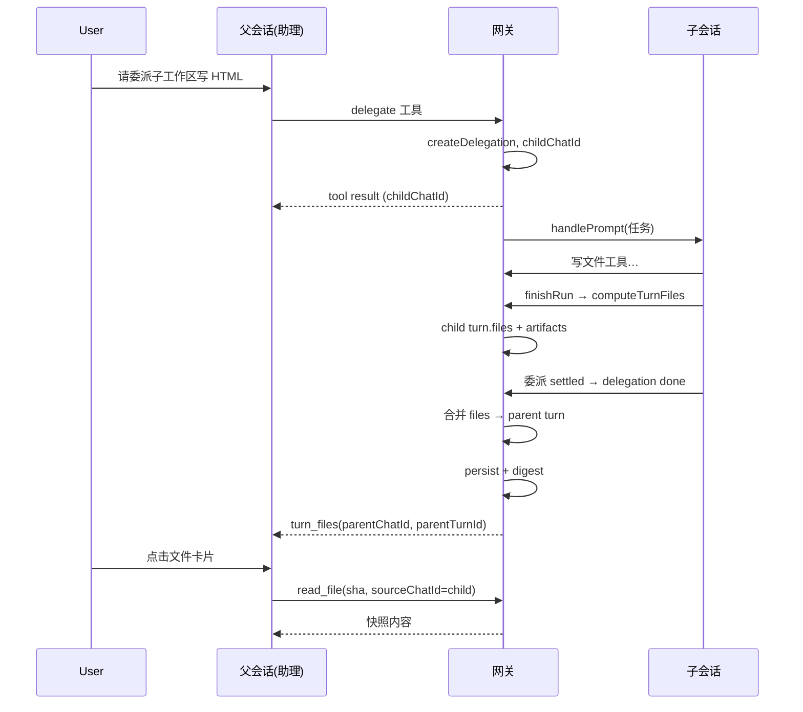

# 委派交付物在父会话的文件卡片：设计说明

> 状态：方案（未实现）  
> 相关：[chat-sync.md §5.1](./chat-sync.md#51-每轮文件清单turnfiles与快照)、[iphone-assistant-first.md](./iphone-assistant-first.md)、画布 [ios-chat-file-card-plan](../../.cursor-remote/canvases/ios-chat-file-card-plan.canvas.tsx)

## 1. 问题陈述与用户故事

**问题**：个人助理（USER 根目录会话）通过 `delegate` 把活交给子工作区子会话。子会话里 Agent 用写文件工具产出 HTML、画布、Markdown 等交付物。网关已在子会话**该轮结束**时计算 `turn.files` 并落盘（见 chat-sync §5.1），但父会话（助理）那一轮往往在 `delegate` 工具**立即返回** `childChatId` 后就已收尾，父轮 `turn.files` 只反映助理侧工具，**不包含**子会话写出的文件。

**后果**：

- 父会话线程里用户只能看到委派文字汇报或工具 JSON，**没有**与本地 Agent 轮次一致的一键文件卡片。
- 父会话连接在子会话跑完时收到的是 `delegation_state` / 收件箱，**不会**收到子会话的 `turn_files`（该消息只发给子会话 owner）。
- iOS 已在客户端用「子会话最后一轮 `turn.files` + 按需 `load_chat`」做部分补偿（`AssistantActionRow`、`DelegationDetailSheet`），依赖本机是否已同步子会话正文；Web 侧尚无对等逻辑。
- 个人工作区 `delegate` 委派详情若只回文字，父侧同样缺文件卡片路径（与 [ios-chat-file-card-plan](../../.cursor-remote/canvases/ios-chat-file-card-plan.canvas.tsx) 中「完整文件卡片需网关挂进 turn.files」一致）。

**用户故事**：

1. **可乐（助理会话）**：委派子工作区生成报告 HTML 后，在助理回复或 `delegate` 工具块下方看到文件卡片，点开展历史快照（非仅工作区当前文件）。
2. **手机用户**：委派完成后在助理线程看到最多 3 个紧凑卡片，「全部」进委派详情；详情里展示完整列表（已有 UI 规格，缺稳定数据源时仍可能空白）。
3. **多设备**：在 A 设备发起委派，B 设备打开同一助理会话，仍能看到同一批交付物卡片（与网关落盘、分页拉正文一致）。

## 2. 现状

### 2.1 `turn.files` 的计算与下发

- **时机**：子会话（或任意工作区会话）一轮 `done` 且非 `approval` 时，网关 `attachTurnFiles` → `computeTurnFiles`（`gateway/src/turnFiles.ts`）。
- **来源**：本轮 transcript 中写文件类工具路径 + 相对回合基线的 git 对比；上限 40 文件、8s 总预算、单文件快照 8MB、artifacts 租户配额 1GB（详见 chat-sync §5.1）。
- **落盘**：写入该会话 transcript，合并进 `chats/<chatId>/<seg>.json` 的对应 `HistoryTurn.files`。
- **实时**：`turn_files { chatId, turnId, files }` 只发给**该轮所属会话**的 owner 连接（`gateway/src/index.ts` `finishRun`）。
- **合并保护**：客户端上传回合缺 `files` 键时保留磁盘版（`runlog.ts` `keepTurnFiles`）。

类型定义（`shared/protocol.ts`）：

```ts
export type TurnFile = {
  path: string;       // 工作区相对路径（相对子会话 cwd）
  kind: PreviewKind;
  op: "added" | "modified";
  size?: number;
  sha?: string;       // 内容快照 sha256
  diffSha?: string;
  added?: number;
  removed?: number;
};

export type HistoryTurn = {
  id: string;
  user: string;
  assistant: string;
  tools?: Array<{ callId; name; args?; result?; status; ... }>;
  files?: TurnFile[];
};
```

### 2.2 委派与 `childChatId`

- **创建**：`startDelegation`（`gateway/src/index.ts`）校验工作区、`activeDelegationFor` 互斥，生成 `childChatId`，写 `delegations.json`（`assistant/delegations.ts`），在 `tenant.disk.chats` 插入子会话元数据：`cwd` 为子工作区、`parentChatId`、`delegationId`。
- **工具返回（同步）**：`{ ok, id, childChatId, mode: foreground|background, note }` JSON 字符串；父助理轮在此刻继续/结束，**尚未**有子侧文件。
- **前台**：子会话在父 owner 连接（或备用连接）上跑 `handlePrompt`；`slot.delegationId` 关联审批路由到父会话。
- **结束**：`updateDelegation` → `publishDelegation` → 收件箱 `kind: delegation`；子会话最后一轮 `finishRun` 照常算 `turn.files`（chatId = childChatId）。
- **存储**：子会话正文与其它会话相同（state v2 分段）；委派记录与 `result` 文本在 `assistant/delegations.json`，**不**含文件清单。

### 2.3 子会话 transcript 与客户端

- 网关为唯一正文来源；子会话 `turn.files` 仅在**子 chatId** 的 turn 上。
- iOS：`ensureTurnsLoaded(childId)` 拉子正文；`openTurnFile` 用 `(chatId, TurnFile.sha)` 走 `read_file` / `/media?rev=sha:…`（快照在租户 `artifacts/`，与子 cwd 无关）。
- Web：协议含 `turn_files`，组件层尚未像 iOS 一样绑定展示；助理会话内 `delegate` 无子文件卡片。

## 3. 目标与非目标

**目标**

- 父会话（至少助理 `parentChatId` 会话）在委派**完成**后，能稳定展示子会话交付物文件卡片（含 sha 快照能力）。
- 与现有 `TurnFile` / `read_sha` / 40 上限 / artifacts 配额语义一致。
- 多设备通过落盘 + `load_chat` 可见，不依赖「当时是否连着子会话 owner WebSocket」。

**非目标**

- 不替代子会话完整工具过程与全文历史（仍进子 chat 或委派详情）。
- 不在委派 **running** 期间在父会话伪造「已完成」的文件卡片（可显示进行中占位，P1）。
- 不改变子工作区 cwd 规则、不合并两个会话的正文为一条 transcript。
- 不要求 background 委派（只读、无写文件批准）一定有文件卡片，除非子侧确实写出文件且 policy 允许。

## 4. 方案对比

| 维度 | A. 合并到父轮 `turn.files` | B. 扩展 `delegate` 工具 `result.files` | C. 纯 UI 拉子会话最后一轮 |
| --- | --- | --- | --- |
| **做法** | 子会话 `done` 且委派 `done/failed` 时，网关把子**最后一轮**（或累计交付轮）的 `TurnFile[]` 写入父会话**含该 delegate 工具的那一轮**的 `files`（或追加键） | 委派结束时 PATCH 父 turn 内对应 tool 的 `result` 对象，增加 `files`、`childTurnId` | 客户端从 `childChatId` 读 `turns.last.files`，挂工具块下 |
| **落盘** | 父 turn 上有 `files`，与 chat-sync 一致 | `files` 嵌在 tool result JSON 里，与 `turn.files` 两套 | 仅子 turn 有 `files` |
| **多设备** | 好（分页拉父会话即得） | 好（若在 transcript 内） | 差（需每台设备拉子正文或元数据触发加载） |
| **快照/sha** | 复用已有子轮快照，路径相对**子 cwd** | 同左，需约定打开时用 `childChatId` | 同左，iOS 已实现 |
| **异步** | 需二次写父 transcript + rev+digest | 同左 | 无网关改动 |
| **与 40 上限** | 父轮 files 与子轮共享语义，需 dedupe | 可单独 cap | 子轮已有 cap |
| **running** | 需约定是否清空或延迟写入 | 可 result 增量更新（复杂） | 子轮未完成则无 files |
| **实现面** | 网关 finishDelegation + 合并 turn | 网关改 tool result + 客户端解析 | iOS 部分已有；Web/父会话弱 |

**方案 D（补充）**：新 ServerMessage `delegation_files { delegationId, parentChatId, parentTurnId, childChatId, childTurnId, files }`，仅推送不写入父 turn。  
优点：不改 HistoryTurn 形状；缺点：不落盘则多设备不一致，与 v2「网关唯一正文来源」原则冲突，**不推荐为主方案**。

## 5. 推荐方案

**推荐：A 为主，B 为可选冗余字段（P1）**

1. **网关（P0）**：在委派进入终态（`done` / `failed`，含用户取消）且子会话已 `flushTranscript` 后，执行 **attach delegation artifacts to parent turn**：
   - 定位：`parentChatId` 会话中，tools 里 `name === "delegate"` 且 `result` 解析后 `id === delegationId`（或 `childChatId` 匹配）的**那一轮** `parentTurnId`。
   - 内容：取子会话**最后一轮** `childTurnId` 的 `files`（若 failed 且无 files 则写空或不写键）。
   - 合并策略：若父轮已有 files（助理自身写出），**追加**子 files，按 `path` 去重，总数 **≤ MAX_TURN_FILES（40）**，超出截断并可在 `delegation.result` 或日志注明。
   - 写盘后：`rev++`、`broadcastDigest`；向**父会话**相关连接发 `turn_files { chatId: parentChatId, turnId: parentTurnId, files: merged }`（或全量替换父轮 files 列表，客户端以 turnId 合并）。

2. **协议（P0 最小扩展）**：在 `TurnFile` 上增加可选溯源（草案）：

```ts
export type TurnFile = {
  // ...现有字段
  /** 文件实际所属会话；缺省为当前 turn 所在 chatId */
  sourceChatId?: string;
  /** 清单来源回合；缺省为当前 turnId */
  sourceTurnId?: string;
};
```

   - 打开预览：`read_file { chatId: sourceChatId ?? active, path, sha }`；`cwd` 解析用**源会话**磁盘上的 `cwd`（子工作区）。
   - 不扩展时：客户端约定「父助理会话里 path 一律按 `delegation.workspace` 对应子 cwd 解析」，但多委派/路径冲突时 **sourceChatId 更安全**。

3. **客户端（P0）**：
   - **Web**：助理线程在 turn 末尾 / `delegate` 工具块下渲染 `turn.files`（与子会话相同组件规则）；收到 `turn_files` 更新父 turn。
   - **iOS**：保留 `AssistantActionRow` 子会话拉取作为**加速**；若父 turn 已有 `files`（含 sourceChatId），优先父 turn，避免未加载子正文时空白。

4. **B（P1 可选）**：委派完成时同步更新 tool `result`：`{ ok, id, childChatId, files?: TurnFile[], childTurnId?: string }`，便于只解析 tools 的旧客户端；**以落盘父 turn.files 为准**。

### 5.1 数据流（推荐）



## 6. 客户端展示位置

| 位置 | iOS | Web |
| --- | --- | --- |
| 助理正文末尾 | 与其它轮相同：`TurnFileCards` 插在正文后（父 turn.files 有值时） | 同等：回合级 files 区 |
| `delegate` 工具块下 | 已有 `AssistantActionRow` 紧凑行（3 个）；应与父 turn.files **去重或二选一**，避免双份 | 新增：解析 delegate 行 + 父 turn files |
| 委派详情 | `DelegationDetailSheet`「文件」区：子最后一轮（保留，作 drill-down） | 可选：助理面板 / 子会话跳转 |
| 收件箱 | 仅文字 `body`；P1 可加 deep link 到父 turn | 同左 |

**原则**：父会话「一点即开」的主入口是 **父 turn.files（带来源字段）**；委派详情展示子会话全量过程 + 完整文件列表。

## 7. 快照与 sha

- 快照仍在**租户** `stateDir/artifacts/<sha>`，与子/父 chatId 无关；子会话 `computeTurnFiles` 已写入。
- 父会话打开时：**chatId 用 `sourceChatId ?? 父 id`**，**sha 用 TurnFile.sha**；diff 用 `diffSha`。
- 禁止在父会话对子路径再算一遍快照（避免重复配额与 cwd 错误）。
- 子轮被截断（清单超时无 sha）时：父卡片行为与子一致——打开当前工作区版本或提示「历史版本已清理」。

## 8. 边界与异常

| 场景 | 行为 |
| --- | --- |
| 委派 **running** | 父轮不写入子 files；iOS 可继续显示「处理中」无卡片 |
| 委派 **awaiting**（子侧审批） | 无最终 files；审批通过后子轮继续，完成后再 attach |
| 委派 **failed** / 取消 | 若有 partial 子 turn.files 可 attach；否则无 files |
| **40 文件上限** | 合并后截断；优先子交付物或按时间排序需在实现中固定规则（建议：子 files 优先，再父自身） |
| 多轮子会话 | 默认取 **最后一轮** files；若最后一轮无写文件但前一轮有，可改为「委派期间所有 turn files 合并去重」（P1） |
| 同一父轮多次 delegate | 按 `delegationId` 匹配 tool；各委派完成时更新**同一父轮**对应 tool 区间或分拆到不同父轮（通常一轮一个 delegate） |
| **background** delegate | 只读模式若仍产生文件（异常/策略变更），仍 attach；否则仅 result 文本 |
| 网关重启 | `recoverDelegations` 标 failed；子 transcript 可能已有 files，attach 逻辑应在恢复后或下次读盘时 idempotent |
| 帧大小（iOS 900KB） | `turn_files` 列表过大时需 `shrinkMessage` 裁切或只发 digest 让客户端拉 turn（已有模式可参考） |
| 审批写文件 | 子会话 `approval` 轮不算 files；最终 completed 轮才算 |

## 9. 分阶段实施（仅计划）

### P0

- 网关：委派终态 hook → 找父 turn → 复制/合并子最后一轮 `TurnFile[]` → 写父 transcript → digest + `turn_files` 指向父 chatId。
- 协议：`TurnFile.sourceChatId` / `sourceTurnId`（或等价文档化 cwd 映射规则）。
- Web：父会话 turn files 渲染 + 处理 `turn_files`。
- iOS：父 turn 有 files 时优先展示；减少仅依赖 `ensureTurnsLoaded(child)` 的空窗。
- 测试：`turnfiles-smoke` 风格用例 + 委派 E2E（假模型写 `.cursor-remote/` 下小文件）。

### P1

- tool result 冗余 `files` 字段；委派 running 期间子会话 `turn_files` 转发到父连接（可选，仅 UI 进度）。
- 多 turn 合并、截断提示 UI、「全部 N 个文件」与父 turn 一致。
- `delegation` 收件箱项带 `parentChatId` + turn 锚点（若尚无）。

## 10. 验收标准与测试场景

**验收**

1. USER 根助理会话：delegate 完成后，父会话该轮出现 ≥1 个文件卡片，点击用 sha 打开子工作区路径下的历史内容。
2. 第二台设备只打开助理会话、未打开子会话：拉父正文后卡片仍在。
3. 子会话 `DelegationDetailSheet` / 子 chat 内 files 与子轮一致；父卡片与子 sha 相同。
4. failed 委派无文件时不出现空卡片；有 partial 文件时卡片数正确。
5. 40+ 文件时父列表 capped，无崩溃；iOS 帧不 drop（或回退拉 turn）。
6. 回归：非委派会话 `turn.files` 行为不变；`keepTurnFiles` 合并保护仍有效。

**测试场景**

- 前台委派：写 HTML + canvas 各一，审批一次后完成。
- 子工作区 cwd 与 USER 根不同，验证 `read_file` cwd。
- 同一助理轮先本地写文件再 delegate（父+子 files 合并去重）。
- background 委派（无写文件）：父无卡片。
- 网关重启中断委派：状态 failed，父无误挂 files。
- Web slim_state 仅 metadata：打开父会话加载最后一页即见 files。

## 11. 参考实现位置（阅读用）

| 模块 | 路径 |
| --- | --- |
| turn.files 计算 | `gateway/src/turnFiles.ts`, `attachTurnFiles` in `gateway/src/index.ts` |
| 委派生命周期 | `gateway/src/index.ts` `startDelegation`, `assistant/delegations.ts` |
| 协议类型 | `shared/protocol.ts`, `web/lib/protocol.ts` |
| iOS 委派 UI | `ios/.../ThreadView.swift` `AssistantActionRow`, `DelegationDetailSheet.swift` |
| 同步说明 | `docs/chat-sync.md` §5.1 |

---

*文档版本：2026-10-06，方案阶段，不含实现提交。*
